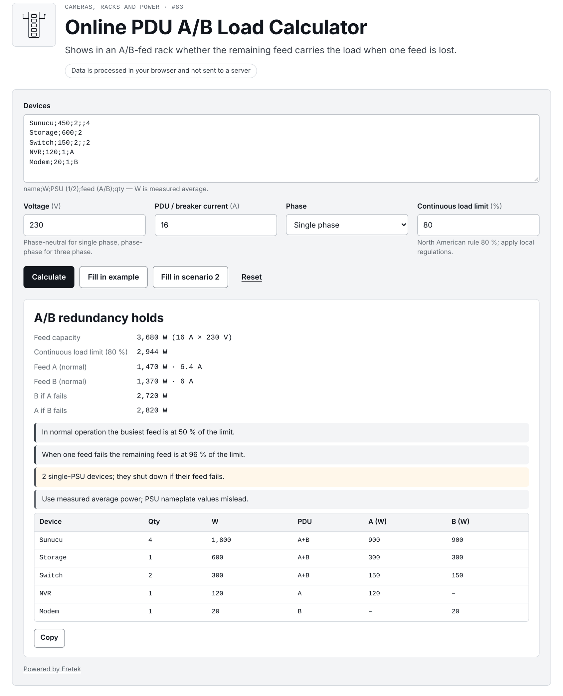

# PDU A/B Load Calculator

Calculate A/B PDU load for dual- and single-PSU devices, the load the remaining feed carries when one fails, and sufficiency against breaker/outlet limits.

## Try it live

- [Türkçe](https://kamera.eretek.com/araclar/pdu-kapasite-hesaplama)
- [English](https://kamera.eretek.com/en/tools/pdu-ab-load-calculator)
- [Deutsch](https://kamera.eretek.com/de/werkzeuge/pdu-ab-lastrechner)



## What it does

Shows in an A/B-fed rack whether the remaining feed carries the load when one feed is lost.

Dual-PSU servers normally share load equally between two PDUs, but when one feed drops the whole load moves to the other. If both PDUs are above 50 % in normal operation, the breaker trips at the first failure and redundancy is useless. The tool compares normal and failure scenarios with the limit.

## Where it helps

Keep each feed's normal load below 50 % of the limit. Take watts from iDRAC/iLO or smart PDU readings; nameplate values mislead.

## How to use it

1. Enter devices as `name;W;PSU count;feed;qty`. With 1 PSU feed is A or B; empty means alternate.
2. Enter voltage, PDU/breaker current, phase and continuous load limit (80 %).
3. Press Run.

### Fields

| Field | Description |
|---|---|
| Devices | name;W;PSU (1/2);feed (A/B);qty — W is measured average. |
| Voltage | Phase-neutral for single phase, phase-phase for three phase. |
| PDU / breaker current |  |
| Phase |  |
| Continuous load limit | North American rule 80 %; apply local regulations. |

## Example input

Press **Fill in example** in the tool to load this input.

| Input | Value |
|---|---|
| Voltage | `230` |
| PDU / breaker current | `16` |
| Phase | `Single phase` |
| Continuous load limit | `80` |

**Devices**

```text
Sunucu;450;2;;4
Storage;600;2
Switch;150;2;;2
NVR;120;1;A
Modem;20;1;B
```

**Expected result:** Normally A 1,470 W, B 1,370 W; if A fails B carries 2,720 W, if B fails A carries 2,820 W. Limit 2,944 W (16 A × 230 V × 80 %): sufficient but tight at 96 %.

## Method and assumptions

Dual PSU: load split equally in normal operation, all on the remaining feed on failure. Single PSU: full load on its feed; the device shuts down if that feed fails. Capacity = V × A (× √3 for three phase); limit = capacity × continuous load share.

## Limits and common mistakes

- Phase imbalance and sub-breaker banks on the PDU (e.g. 2 × 8 A) are not modelled; dual PSUs may share unequally.

## Run it locally

The tool is plain HTML, CSS and JavaScript with no build step and no dependencies.

```bash
git clone https://github.com/eretek/pdu-ab-load-calculator.git
cd pdu-ab-load-calculator
node scripts/serve.js        # or: python3 -m http.server 8080
```

Open <http://127.0.0.1:8080/>. Add `?lang=tr` or `?lang=de` for Turkish or German; without it the page follows the browser language and falls back to English. You can also open `index.html` directly from disk.

Run the tests (Node.js 18 or later):

```bash
node test/run.js    # or: npm test
```

The tests run the tool's own fixtures and the worked examples in all three languages without a browser.

## How it works

All processing happens in your browser. The tool makes no network requests, uses no cookies or browser storage, and does not upload files you select.

No server-side component is needed. The version on the Eretek website renders the same page through a private WordPress plugin; that plugin only produces the page markup and is not part of this repository.

| Path | Purpose |
|---|---|
| `index.html` | Page shell |
| `src/app.js` | Builds the page in Turkish, English or German from `src/data.js` |
| `src/data.js` | Field definitions, examples and all texts in three languages |
| `src/core.js` | Shared runtime: validation, number formats, result rendering, CSV/ICS export |
| `src/tool.js` | The calculation or analysis for this tool |
| `docs/screenshot.png` | Screenshot used in this README |
| `src/tools.css`, `src/page.css` | Styles |
| `test/run.js`, `test/cases.json` | Headless tests |

## License and attribution

This tool is released under the [Eretek Website Attribution License](LICENSE). You may use, modify and redistribute it, including commercially. If you make it available on a website or web application, show a visible, clickable credit linking to https://eretek.com/ on every page where the tool is available, for example:

```html
<a href="https://eretek.com/">Powered by Eretek</a>
```

You may add `rel="nofollow"` to the link. Keep the copyright notice and license text in copies and redistributions.
